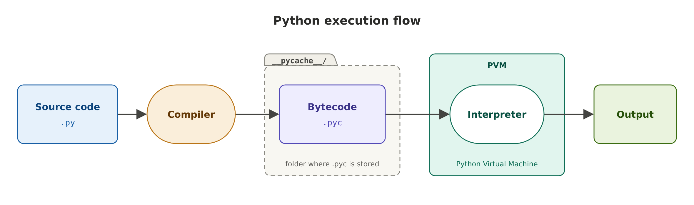

### Python basics
1. Python files ends with .py extension, use .ipynb if they comes from jypter notebook
2. when you run directly .pyc file wont be created or referred
3. 

### How internally works

